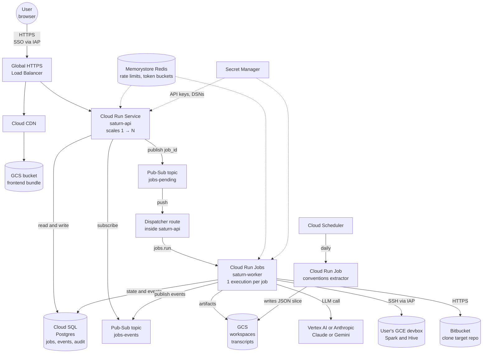
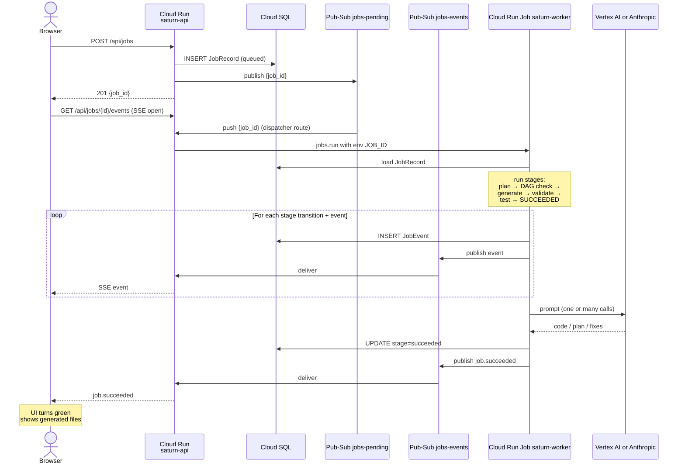
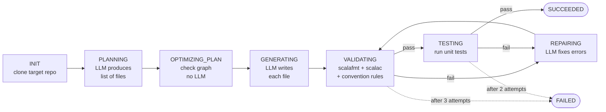

# Saturn Agent — Architecture & Deployment

A plain-English overview of what the system does, how the pieces fit together,
and how it would run on GCP in production.

For local-dev setup, see `README.md`. For deeper design rationale, see `HLD.md`
and `LLD.md`.

---

## 1. What this system actually does

Saturn Agent takes a short **pipeline spec** (input tables, output tables, the
transformation in plain English) and produces a **per-job workspace** with
Scala source files, DDL, and tests — code that compiles, passes the firm's
convention rules, and runs its own unit tests.

The user reviews the result, commits, and opens a PR. The agent does the
"hard, tedious part" (writing boilerplate Scala that matches the repo's
conventions); the human stays in the loop for the parts that need judgment.

---

## 2. The big picture (production on GCP)



If you've never seen the GCP names before, here's the one-line version of
each:

| Thing | What it really is |
|---|---|
| **Cloud Run Service** | "Run this container; auto-scale it based on incoming requests." For the API. |
| **Cloud Run Job** | "Run this container once, to completion, then stop." For each agent run. |
| **Pub/Sub** | A durable message bus. Producers drop messages on a "topic"; subscribers receive them. |
| **Cloud SQL** | Managed Postgres. |
| **Memorystore** | Managed Redis. |
| **GCS** | Object storage (like S3). |
| **IAP** | Identity-Aware Proxy. Lets users (and services) reach private resources through SSO, no VPN. |
| **Vertex AI** | GCP's LLM endpoint. |

---

## 3. How a single job flows end-to-end

The story, in plain English:

1. **User fills the form.** "Pipeline name `foo_reports`, target repo
   `saturn-pipelines-reports`, here's the transformation in two sentences."
2. **Browser POSTs to the API.** API saves the job to Postgres and drops a
   `{job_id: "abc"}` message on the `jobs-pending` Pub/Sub topic. Returns
   `201 Created` instantly. User sees the new job in the list.
3. **The browser navigates to the job page** and opens a streaming SSE
   connection so it can watch progress live.
4. **Pub/Sub pushes the message** to a small "dispatcher" inside the API. The
   dispatcher tells GCP "please start one execution of the `saturn-worker`
   Cloud Run Job, with `JOB_ID=abc` as an environment variable."
5. **GCP launches a worker container.** It boots in ~5 seconds, reads the job
   from Postgres, and starts running through the stages.
6. **As each stage progresses, the worker writes events** (`plan.parsed`,
   `file.generated`, `validation.passed`, etc.) to two places: Postgres (the
   permanent record) and Pub/Sub (the live feed).
7. **The API replica holding the user's SSE connection** is subscribed to that
   live feed, filters for the right `job_id`, and pushes each event to the
   browser. The UI updates in real time.
8. **When the worker reaches SUCCEEDED**, it tarballs the workspace to GCS,
   publishes a final `job.succeeded` event, and the container shuts down.
9. **The user reviews the generated files**, then commits and opens a PR
   manually. PR creation is intentionally not automated.

That's it. The whole system is variations on this one flow.

### As a sequence diagram



---

## 4. The five pieces of the system

### a) Frontend (React + Vite)

Two pages: **JobsList** (table of recent jobs, a "New job" button) and
**JobDetail** (live progress, plan, event tape). Static bundle served from
GCS through the CDN. Talks to the API over HTTPS only.

### b) API server (FastAPI on Cloud Run Service)

Stateless. Three responsibilities:

- Accept job creation, persist to Postgres, drop a message on `jobs-pending`.
- Serve `GET /api/jobs/...` for the UI.
- Hold the SSE connection that streams events back to the browser.

A fourth route, `/pubsub/dispatch`, lives in the same image — it's the small
dispatcher that converts incoming Pub/Sub messages into Cloud Run Job
executions.

### c) Worker (separate container on Cloud Run Jobs)

This is where the real work happens. Same Python codebase, but a different
container image because it also needs the JDK + Scala + sbt + scalafmt
(~2.5 GB image vs. the API's ~250 MB).

One execution = one job, end to end. Container starts, runs the orchestrator,
exits. No idle workers, no pool to babysit, no Kubernetes.

### d) Conventions extractor (Cloud Run Job on a schedule)

A separate tiny container that runs daily. It parses the target Scala repos
using tree-sitter and produces a `conventions.json` file per repo. Result
goes to GCS. Workers read this file when they start a job, so the agent
"knows" what style and patterns the target repo uses.

### e) Data layer

- **Cloud SQL (Postgres)** — single source of truth for jobs, events, and
  audit log.
- **Memorystore (Redis)** — rate-limit counters, token buckets, ephemeral
  state.
- **GCS** — workspace tarballs, LLM transcripts, conventions JSON.
- **Secret Manager** — API keys, DB DSNs, Bitbucket tokens.

---

## 5. How the worker actually generates code

This is the part most people are curious about. Three things to know:

### a) It's ONE agent, not many

There's no multi-agent dance. A single LLM "agent class" exists. The
orchestrator (a plain Python state machine) decides when to call it, in what
mode, and with which tools.

The agent runs in different "modes" by swapping three things:

- **System prompt** — planner / generator / repair templates.
- **Allowed tools** — the planner can only read; the generator can also write
  files; the repair stage can do both. This is a real security boundary, not
  just convention.
- **User message** — the actual ask for this step.

### b) Stages step through deterministically



The repair loop is bounded — at most 3 validation retries, 2 test retries.
This is the "agent can't spiral forever" guarantee. The orchestrator code,
not the LLM, is what enforces it.

### c) Files are generated one at a time, sequentially

For each file in the plan, the worker:

1. Picks the right "skill" file (pipeline-builder / ddl-builder / tester) and
   loads it as the system prompt.
2. Builds a user message containing the file's description **plus the actual
   bodies of any upstream files it depends on**. (So if `FooProvider.scala`
   depends on `FooNode.scala`, the LLM sees the real `FooNode` code, not a
   prose description of it.)
3. Starts a fresh LLM agent loop. The agent calls tools (`read_file`,
   `grep`, eventually `write_file`) until it's done, capped at 25 round
   trips.
4. Moves to the next file.

So a 6-file job is 6 separate LLM conversations, run back-to-back. They all
share the same total token budget.

### What if code is too long?

| Problem | What happens | Fix |
|---|---|---|
| One file's body exceeds the LLM's output limit | The file is missing or truncated → job fails cleanly with `generation.missing_file` | Bump `max_tokens` (env var), or have the planner split the file |
| The input prompt is too big (deep DAGs) | LLM call errors → job fails | Switch to "summary-only" mode for upstream files (future work) |
| Total tokens exceed the per-job budget (default 500k) | `TokenBudgetExceeded` → job fails | Raise the budget, or simplify the plan |
| The agent loops calling tools forever | Loop hits 25 iterations → job fails | Usually means the prompt is ambiguous — fix the skill / prompt |

In all four cases the system fails *cleanly* with a clear event in the
journal. It never burns infinite tokens.

---

## 6. How the UI sees progress

```mermaid
flowchart LR
    user(("Browser")) -->|GET /events/replay<br/>(once on page load)| api[saturn-api]
    api -->|history from Postgres| user
    user -->|GET /events<br/>(SSE, held open)| api
    worker[Worker] -->|each event<br/>publishes| ps[Pub-Sub<br/>jobs-events]
    ps -->|filter job_id| api
    api -->|push as SSE| user
    user -->|browser auto-reconnects<br/>after 60min Cloud Run cap| api
```

In plain words:

1. When the user opens a job page, the browser does two things back-to-back:
   - **Replay**: fetches the events that already happened, as a plain JSON
     array. This catches you up if you arrive mid-job.
   - **Stream**: opens a long-lived SSE connection for new events.

2. The worker publishes every event to a Pub/Sub topic. Each API replica is
   subscribed to that topic with a filter on the user's `job_id`. New events
   get pushed down the SSE connection to the browser.

3. The browser handler updates React state — the stage pill changes color,
   new event rows appear, the plan section renders once the `plan.parsed`
   event arrives.

4. **Disconnects are handled for free.** If the SSE connection drops (Cloud
   Run caps HTTP at 60 minutes, laptops close, networks blip), the browser
   auto-reconnects and the replay endpoint backfills anything missed. The
   user just sees a tiny stall, never a broken view.

---

## 7. What we cache (biggest wins first)

| Cache | Where | What it saves |
|---|---|---|
| **LLM prompt prefix** (Claude `cache_control` / Vertex context caching) | LLM client | 50–70% of LLM cost on a multi-file job. The system prompt is the same across many calls; pay full price once, then ~10% per subsequent call. |
| **sbt / Coursier dependency cache** | Baked into the worker image | 1–3 minutes per job. Without this, sbt re-downloads JARs on every cold start. |
| **Conventions JSON** | GCS, written by the daily extractor | A few seconds per job, plus consistency — every job uses the same authoritative slice. |
| **Warm-mirror clones of target repos** | GCS, refreshed every 15 min | 10–60 seconds per job on initial git clone. Only worth doing if clone time shows up on the critical path. |
| **Idempotent LLM-response cache** (opt-in) | Memorystore | Useful for the eval harness and "regenerate from this stage" debug flows. Not for normal user jobs. |

What we **don't** cache: job results, workspace contents, per-user data.
Each job is a fresh request.

---

## 8. Rate limits and cost control

Two dimensions, both enforced. Tokens are the one that actually controls
spend.

### Request-rate limits (the cheap layer)

| Limit | Default |
|---|---|
| Authenticated requests per user per minute | 60 |
| Concurrent in-flight jobs per user | 3 |
| Concurrent worker executions globally | 8 |
| IP-level RPS at the load balancer | 100 |

Backed by Memorystore Redis counters and a small FastAPI middleware.

### Token budgets (the layer that actually matters)

Token cost ≫ infra cost for this workload. Without token caps, one user
can spend hundreds of dollars on a runaway job. Four gates, all checked
**before** the worker starts:

| Cap | Why |
|---|---|
| Per-job hard cap (default 500k tokens) | Already implemented in `TokenBudget`. Keep it. |
| Per-user per day | Stops accidental Friday-night spirals. |
| Per-user per month | Budget alignment. |
| Per-provider tokens-per-minute | Protects against the LLM provider's own rate limits — back off cleanly instead of getting 429'd. |

### Cost alerting (the safety net)

GCP Budgets + Cloud Monitoring on daily LLM spend, per-user usage
approaching cap, and worker execution-minutes. Alerts go to Slack /
PagerDuty, **not silently to email.**

---

## 9. How testing the generated code works

The worker generates two kinds of tests:

- **Pure-Scala tests** (no Spark) — run **inside the worker container**.
  `sbt`, `scala`, `scalafmt` are baked into the image. The worker shells
  out, runs the tests, parses the output, feeds it back to the agent.
- **Spark-using tests** — run **on the user's GCE devbox**. The worker
  detects "this file imports Spark" by grepping the file content, then
  SSHes into the user's VM via **IAP tunnel + service-account impersonation**
  (no keys, no public IPs, every command logged in Cloud Audit Logs).

Either way, the results come back as events on the journal. If tests fail,
the orchestrator triggers a REPAIR stage (up to 2 attempts). If they pass,
the job goes to SUCCEEDED.

---

## 10. Failure handling

The system is designed so failures are **bounded, attributed, and
debuggable**:

- **Every action is journaled.** LLM calls, tool calls, stage transitions,
  errors — all written to Postgres with timestamps. You can replay any job
  end-to-end from the event tape.
- **Retries are bounded.** 3 validation attempts, 2 test attempts, 25
  tool-loop iterations, 500k tokens per job. None of these can be exceeded
  without a code change.
- **Workspaces are tarballed to GCS on terminal stage** (whether SUCCEEDED
  or FAILED). You can pull down a failed job's workspace days later to
  debug.
- **The agent is bounded by its tool set.** The planner literally cannot
  write files because `write_file` isn't in `PLANNING_TOOLS`. The agent
  can't "go rogue" outside the workspace because `ToolContext` rejects any
  path that resolves outside it.

---

## 11. Why this shape (one-line answers)

| Decision | Why |
|---|---|
| Single agent, not multi-agent | Replayable, cost-bounded, debuggable. Wall-clock speedup of parallel agents isn't worth the chaos for 5–30 internal users. |
| Cloud Run Jobs (not GKE) | Scales to zero. No cluster to operate. One execution = one container = one job. |
| Pub/Sub for dispatch | Backpressure for free. If 50 jobs arrive at once, the queue absorbs them. No `503`s. |
| Pub/Sub (or LISTEN/NOTIFY) for events | Allows multiple API replicas to share live events without sticky sessions. |
| Two container images | API needs no Scala (~250 MB, fast cold start). Worker needs JDK + Scala + sbt (~2.5 GB). Mixing them slows API cold starts pointlessly. |
| Stop at SUCCEEDED, leave PR manual | Bounded, auditable, easy to demo. Auto-PR is a separate, opinionated decision; defer until the workflow is loved. |
| Token budgets enforced pre-dispatch | LLM cost is the dominant cost. A `$50` job that should've been a `$2` job is the failure mode to engineer out, not monitor after. |

---

## 12. Glossary

- **Spec**: the small YAML file describing what pipeline to generate.
- **Plan**: the LLM's structured output saying which files to write, in what
  order, with what dependencies. Validated and topologically sorted by the
  orchestrator before any file is generated.
- **Stage**: one step of the orchestrator (INIT, PLANNING, GENERATING, ...).
- **Skill**: a long Markdown document describing how to write a particular
  kind of Saturn artifact. Used as the system prompt during generation.
- **Conventions slice**: a JSON file produced by the daily extractor,
  capturing the style and patterns of a specific target repo. Fed into the
  planner and generator prompts.
- **Journal**: the per-job event tape. Every LLM call, tool call, stage
  transition, and error is recorded here. It is the source of truth for the
  UI, the audit log, and debugging.
- **Workspace**: the per-job directory (`/workspace/<job_id>/`) where the
  cloned target repo and generated files live. Ephemeral — tarballed to GCS
  on completion, then thrown away.
